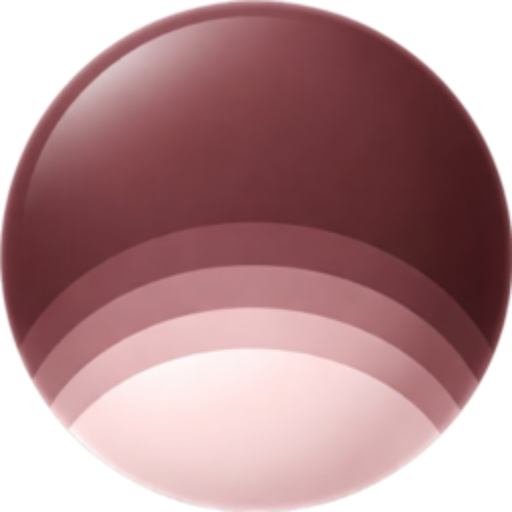

<h1 align="left"><code>Hey there, I'm Rayan!</code></h1>

>   **Data Science & AI Development Intern @ Bravella Health** &nbsp;|&nbsp;  **Computer Science & Math Student @ Ontario Tech University**

I build **full-stack applications**, from responsive web platforms to an award-winning Android app, with a growing focus on **LLMs, AI agents, and intelligent systems**. My co-op experience has shown me how technology can make a real-world impact, motivating me to develop solutions that solve meaningful problems.

Currently sharpening my problem-solving skills through **daily LeetCode practice**, expanding my technical expertise, and seeking new challenges through internships, certifications, and involvement in tech communities across the GTA.

**Feel free to reach out or connect!**

  
  
  

## Tech Stack & Tools

### Languages

### Frameworks & Runtime

### Cloud & DevOps

### AI/ML & Databases

  

<!---
Rayan-Alam-UOIT/Rayan-Alam-UOIT is a ✨ special ✨ repository because its `README.md` (this file) appears on your GitHub profile.
You can click the Preview link to take a look at your changes.
--->
